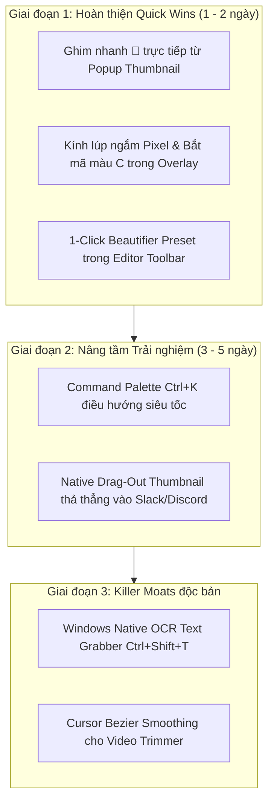

# 🎯 BÁO CÁO PHẢN BIỆN SẢN PHẨM & ĐỘT PHÁ TÍNH NĂNG (PRODUCT TEARDOWN v2)
**Sản phẩm:** SnapDoc (v3.8.4 - Personal Edition)  
**Nền tảng:** Windows Desktop App (Tauri v2 + Rust + React 18 + TypeScript)  
**Đối chiếu chuẩn mực Tier-1:** CleanShot X (macOS #1), Screen Studio (macOS), ShareX (Windows), Snagit (Enterprise TechSmith)  
**Thời điểm đánh giá:** 30/10/2026  

---

## 1. TỔNG QUAN ĐIỀU HÀNH (EXECUTIVE SUMMARY)

* **Điểm số Trưởng thành Sản phẩm (Product Maturity Score):** `8.2 / 10`  
  *(Tăng từ 6.8 sau khi đã giải quyết triệt để 3 tính năng cốt lõi: Tách biệt rõ ràng cụm Chụp/Quay video với icon Camera chuẩn, Smart Empty State cho History, Optimistic Soft Delete với Toast Undo 5s, và Cửa sổ Pin to Screen đa tầng).*
* **Bản chất sản phẩm:** SnapDoc hiện đã vượt xa các công cụ chụp màn hình Windows phổ thông (Snipping Tool, Lightshot) nhờ hiệu năng C++/Rust siêu nhẹ (~50MB installer so với hàng trăm MB của Electron), engine xử lý video native không phụ thuộc cloud, và canvas annotation rất phong phú.
* **3 Tử huyệt Trải nghiệm còn lại (The 3 Critical Friction Points):**
  1. **"Dead-end Thumbnail" (Thumbnail nổi góc màn hình bị thiếu tương tác một chạm):** Cửa sổ thumbnail sau chụp hiện tại chỉ có Copy/Save/Edit. Người dùng thiếu thao tác **Ghim nhanh (📌 Pin)** trực tiếp từ thumbnail, thiếu tính năng **Kéo-thả trực tiếp file ra ngoài (Drag-out to Slack/Discord/Gmail)** mà CleanShot X làm người dùng mê mẩn.
  2. **Thiếu Kính lúp Pixel (Pixel Loupe) & Trích xuất màu HEX nhanh (`C`) khi Chụp vùng:** Khi kéo chọn vùng chụp (`Overlay.tsx`), dev và designer gặp khó khăn trong việc canh chỉnh từng pixel (pixel-perfect) vì thiếu kính lúp phóng to 4x–8x tại tâm trỏ chuột. Đồng thời không thể nhấn phím `C` để copy ngay mã màu HEX của điểm ảnh đang trỏ tới.
  3. **Thiếu Command Palette (`Ctrl+K`) & Quick OCR:** Người dùng bàn phím chuyên nghiệp (Power users) phải dùng chuột click thanh công cụ hoặc nhớ quá nhiều phím tắt riêng lẻ thay vì 1 tổ hợp phím tập trung duy nhất (`Ctrl+K`).
* **3 Cơ hội Vàng Bứt phá (Top 3 Golden Moats):**
  1. **Smart Drag-Out Thumbnail:** Biến thumbnail nổi thành "con thoi" kéo-thả file ảnh/video thẳng vào bất kỳ cửa sổ nào mà không cần bấm lưu ra ổ đĩa.
  2. **Precision Pixel Loupe & Eyedropper:** Tích hợp kính lúp phóng đại quang học + phím `C` lấy màu HEX tức thì ngay trong màn hình chọn vùng chụp.
  3. **1-Click Social Mockup / Apple-Shot Beautifier:** Biến ảnh chụp thô thành ảnh card sản phẩm tuyệt đẹp (tự động căn padding, bo góc mềm, đổ bóng 3D, nền gradient Apple style) chỉ với 1 cú click.

---

## 2. BẢNG ĐỐI CHIẾU HIỆN TRẠNG (SNAPDOC vs TIER-1 BENCHMARKS)

| Tiêu chí Trải nghiệm | SnapDoc v3.8.4 | CleanShot X (macOS) | ShareX (Windows) | Screen Studio / Snagit | Đánh giá & Khoảng cách |
|---|:---:|:---:|:---:|:---:|---|
| **Cụm điều khiển Chụp/Quay** | ✅ Đã tách biệt rõ màu sắc & icon máy quay | ✅ Rất tinh tế | ⚠️ Quá nhiều menu con phức tạp | ✅ Tinh gọn | **Đạt chuẩn Tier-1** |
| **Ghim ảnh màn hình (Pin)** | ✅ Đã có (Opacity, Zoom, Drag, Copy, Editor + History) | ✅ Ghim nhanh từ thumbnail | ⚠️ Ghim đơn giản | ❌ Không có | **Rất tốt** (Chỉ thiếu ghim trực tiếp từ popup Thumbnail) |
| **Empty State & Undo Delete** | ✅ Smart Empty State + Toast Undo 5s | ✅ Có | ❌ Xóa mất luôn | ⚠️ Có confirm | **Đạt chuẩn Tier-1** |
| **Kéo-thả file từ Thumbnail (Drag-out)** | ❌ Chưa có | ✅ Cực mạnh (90% user dùng) | ⚠️ Menu chuột phải | ❌ Không có | **Khoảng cách lớn về TTV (Time-to-Value)** |
| **Kính lúp Pixel (Pixel Loupe) khi chụp** | ❌ Chưa có | ✅ Có zoom 4x + kích thước px | ✅ Có zoom 8x + mã màu HEX | ✅ Có kính lúp | **Tử huyệt khi làm việc với UI/Dev** |
| **Lấy mã màu nhanh (Eyedropper / Press C)** | ❌ Chưa có | ✅ Bấm C copy HEX | ✅ Có Color Picker chuyên sâu | ⚠️ Công cụ rời | **Cần bổ sung ngay** |
| **Command Palette (`Ctrl+K`)** | ❌ Chưa có | ⚠️ Quick search menu | ❌ Không có | ⚠️ Có search | **Cơ hội vượt trội so với ShareX** |
| **Tự động bo nền đẹp (1-Click Beautify)** | ⚠️ Đã có công cụ nền G, nhưng chưa có preset 1-click | ✅ Đẹp xuất sắc | ❌ Phải chỉnh thủ công | ✅ Tự động hoàn toàn | **Cần thêm nút bấm 1-click preset** |
| **Tự động làm mờ nhạy cảm (Smart Redact)** | ⚠️ Đã có Blur/Pixelate/Solid thủ công | ⚠️ Thủ công | ❌ Thủ công | ✅ Tự động nhận diện Email/Credit Card | **Lợi thế lớn cho Snagit** |

---

## 3. DANH MỤC ĐỀ XUẤT TÍNH NĂNG MỚI (3 TẦNG HÀNH ĐỘNG)

### 🚀 Tầng 1: Quick Wins (Triển khai nhanh 1–2 ngày)

1. **Ghim nhanh (📌) & Sao chép nhanh trên Popup Thumbnail (`Thumbnail.tsx`):**
   * *Nghiệp vụ:* Khi chụp ảnh xong, cửa sổ thumbnail nổi lên ở góc dưới màn hình trong 6s. Thêm ngay nút **`📌 Ghim`** vào thanh nút của thumbnail. Người dùng bấm 1 cái là ảnh biến thành cửa sổ nổi Pin to Screen ghim ngay trên màn hình để đối chiếu tài liệu mà không cần vào History hay mở Editor.
   * *Độ khó:* Thấp (0.5 MD). Tái sử dụng trực tiếp `ipc.pinImage(src)` vừa hoàn thiện.

2. **Kính lúp ngắm Pixel & Bắt mã màu (`Overlay.tsx`):**
   * *Nghiệp vụ:* Khi người dùng rê chuột chọn vùng chụp:
     * Hiển thị một khung tròn phóng đại 4x xung quanh hoặc cạnh trỏ chuột, thể hiện rõ từng pixel và tâm ngắm chữ thập.
     * Hiển thị mã màu HEX tại tâm ngắm (ví dụ `#4F46E5` / `rgb(79, 70, 229)`).
     * Phím tắt `C`: Nhấn `C` lập tức copy mã màu HEX vào Clipboard và phát thông báo "Đã sao chép mã màu #HEX", không cần kết thúc lượt chụp.
   * *Độ khó:* Trung bình (1 MD). Render canvas 15x15 pixel scale lên canvas tròn 90px từ ảnh nền snapshot đã capture sẵn trong Overlay.

3. **1-Click Beautifier Preset cho Editor (`Toolbar.tsx`):**
   * *Nghiệp vụ:* Hiện tại SnapDoc đã có sẵn tính năng nền `tool === 'background'`, bo góc và đổ bóng. Thêm 1 nút bấm nhanh **"✨ Làm đẹp (Beautify)"** trên thanh công cụ Editor:
     * 1 click tự động áp dụng preset chuẩn Twitter/ProductHunt: Nền gradient hoàng hôn tím-hồng (hoặc xanh công nghệ), padding 32px, bo góc 12px, đổ bóng mềm 3D `0 20px 40px rgba(0,0,0,0.3)`.
   * *Độ khó:* Thấp (0.5 MD). Tận dụng toàn bộ logic của `background` trong `model.ts`.

---

### 🌟 Tầng 2: Strategic Upgrades (Nâng cấp Chiến lược 3–5 ngày)

4. **Command Palette toàn cục (`Ctrl+K`):**
   * *Nghiệp vụ:* Nhấn `Ctrl+K` ở bất kỳ đâu trong app (hoặc qua phím tắt toàn cục) để mở thanh tìm kiếm thông minh dạng Spotlight/Raycast:
     * Gõ "chụp" $\rightarrow$ Hiện: Chụp toàn màn, Chụp cửa sổ, Chụp vùng, Chụp cuộn.
     * Gõ "quay" $\rightarrow$ Hiện: Quay video, Quay cửa sổ, Bật tắt tiếng micro.
     * Gõ "ghim" $\rightarrow$ Hiện: Ghim ảnh chụp gần nhất.
     * Gõ "lịch sử" $\rightarrow$ Mở thư viện History.
     * Hỗ trợ tìm kiếm theo tên item trong History (`recent captures`).
   * *Độ khó:* 2 MD.

5. **Kéo-thả trực tiếp File từ Thumbnail (Native Drag-Out to External Apps):**
   * *Nghiệp vụ:* Khi thumbnail nổi lên góc màn hình, người dùng chỉ cần nhấn giữ chuột trái vào ảnh thumbnail và kéo thả thẳng sang Discord, Slack, trình duyệt web, Telegram hoặc cửa sổ thư mục Explorer. File ảnh PNG thực tế sẽ được thả vào ứng dụng đích mà không cần qua Clipboard hay mở thư mục Downloads.
   * *Độ khó:* 2 MD (Sử dụng plugin `tauri-plugin-drag` hoặc Windows OLE IDataObject native trong Rust).

6. **Tự động nhận diện & Che mờ vùng nhạy cảm (Smart Redact AI / Regex Pattern):**
   * *Nghiệp vụ:* Khi chụp tài liệu/giao diện chứa Email, Số điện thoại, Mã API Key (bắt đầu bằng `sk-`, `ghp_`), Thẻ tín dụng:
     * Nút "Tự động che mờ" trong Editor tự động quét qua OCR/Canvas text hoặc nhận diện hình chữ nhật để tạo sẵn các layer `BlurAnn` hoặc `solidColor` che kín thông tin nhạy cảm.
   * *Độ khó:* 3 MD.

---

### 💎 Tầng 3: Killer Moats (Rào cản Cạnh tranh Áp đảo)

7. **Windows Native OCR Text Grabber (Sao chép văn bản siêu tốc từ màn hình):**
   * *Nghiệp vụ:* Một phím tắt riêng `Ctrl+Shift+T`: Kéo chọn một vùng màn hình bất kỳ $\rightarrow$ Không lưu ảnh mà tự động bóc tách 100% chữ tiếng Việt/tiếng Anh/mã code trong vùng đó và dán thẳng vào Clipboard. Hỗ trợ giữ nguyên định dạng bảng biểu và code block.
   * *Công nghệ:* Tận dụng trực tiếp API Windows native `Windows.Media.Ocr` (sẵn có trên mọi máy Windows 10/11, không tốn thêm byte dung lượng nào, không cần nạp thư viện tesseract nặng hàng chục MB).

8. **Cursor Smoothing & Dynamic Zoom Effect cho Video (Screen Studio cho Windows):**
   * *Nghiệp vụ:* Screen Studio tạo nên cơn sốt trên macOS vì video quay màn hình có chuột di chuyển uốn lượn mượt mà (smooth bezier cursor) và tự động zoom cận cảnh khi click chuột.
   * *Thế mạnh của SnapDoc:* SnapDoc đã có sẵn `mouseFocusEngine.ts` và cơ chế lưu metadata click/chuột. Việc bổ sung thuật toán nội suy đường cong Bezier cho con trỏ chuột khi xuất video sẽ đưa SnapDoc trở thành phần mềm quay màn hình số 1 trên nền tảng Windows.

---

## 4. LỘ TRÌNH THỰC THI GỢI Ý (ACTIONABLE ROADMAP)

### Khuyến nghị kỹ thuật cho bước kế tiếp:
* **Ưu tiên số 1:** Triển khai **Ghim nhanh 📌 trên Popup Thumbnail** (`Thumbnail.tsx`) vì đã có sẵn nền tảng `ipc.pinImage`. Người dùng sẽ thấy sự tiện lợi tức thì: chụp xong bấm ghim ngay, không cần vào Editor.
* **Ưu tiên số 2:** Thêm **Kính lúp Pixel & Phím `C` copy màu** vào `Overlay.tsx`. Mọi lập trình viên và designer dùng SnapDoc sẽ lập tức coi SnapDoc là công cụ không thể thay thế vì tính năng này.
