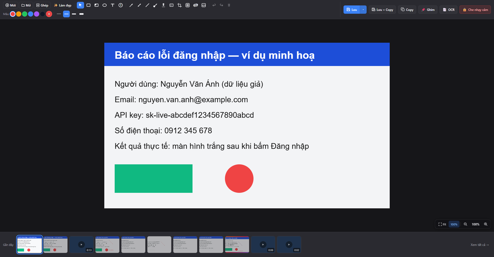
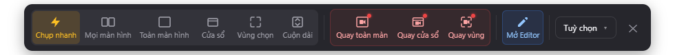
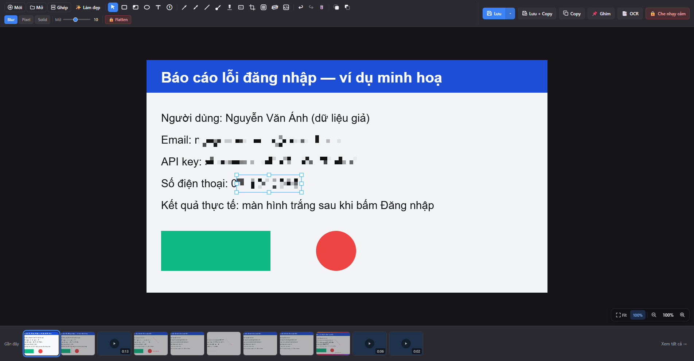
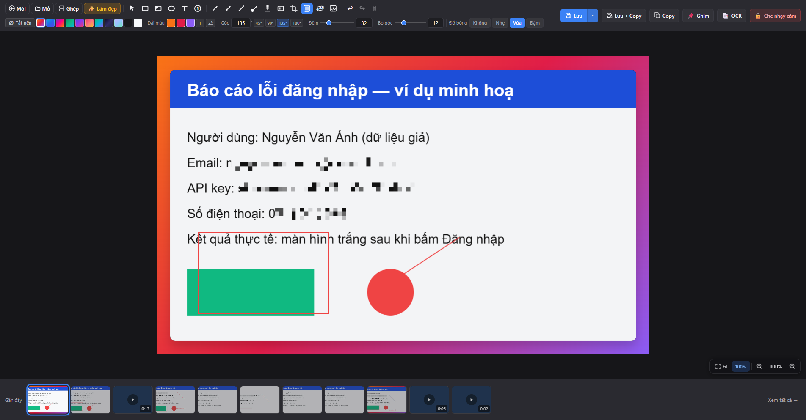
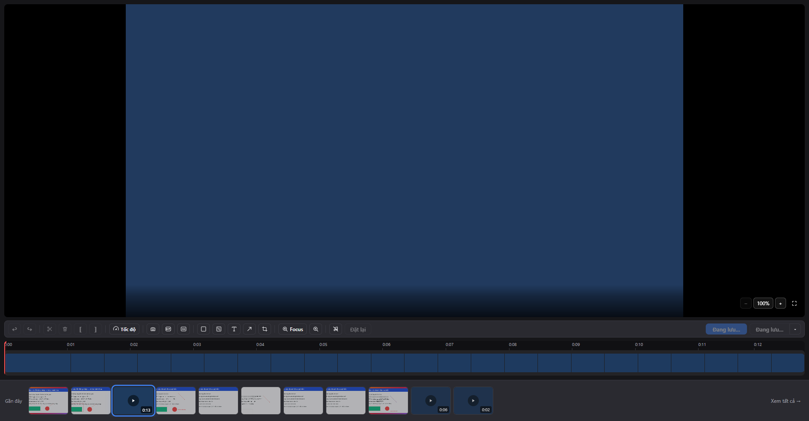
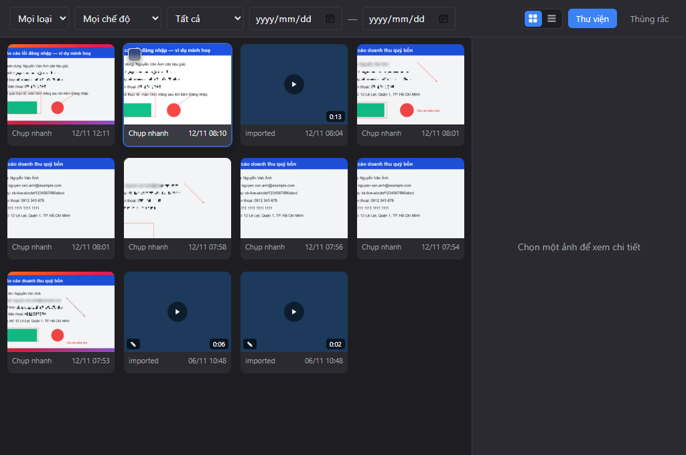
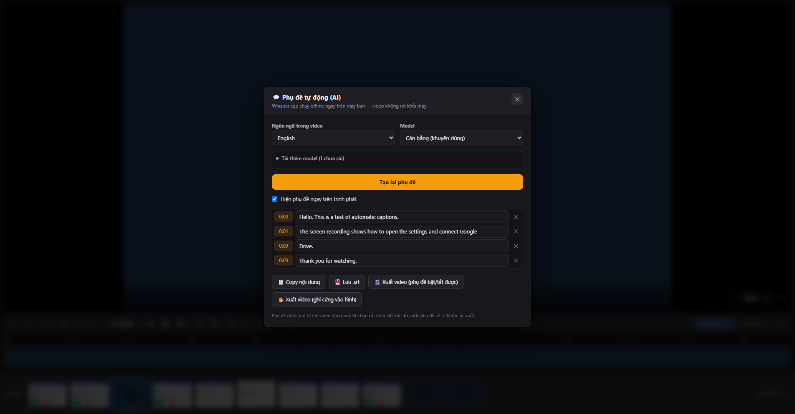
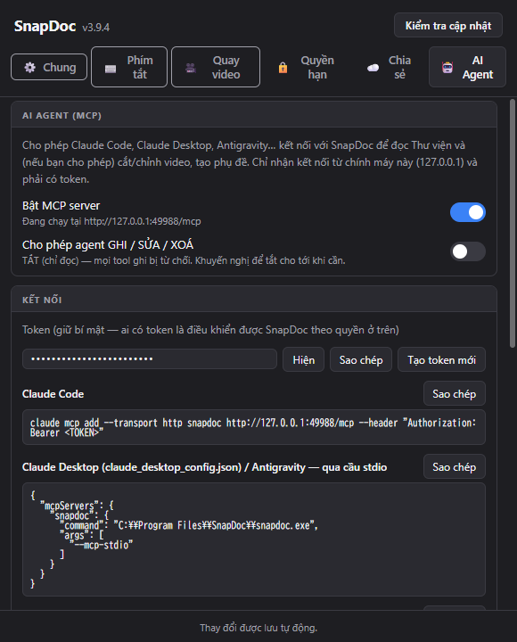

# SnapDoc

<p>
  <strong>Language / Ngôn ngữ:</strong> <b>English</b> | <a href="README.vi.md">Tiếng Việt</a>
</p>

**SnapDoc** is a Windows app to **capture the screen, record video, annotate, extract text (OCR), generate AI subtitles**, and keep everything in one Library — all processed **on your own machine**, no account required.

> Stack: **Tauri 2** (Rust) + **React 19 + TypeScript + Vite** + **Konva** (canvas) + **FFmpeg** (video) + **Whisper.cpp** (offline subtitles).
> See [ARCHITECTURE.md](ARCHITECTURE.md) · [BUILD.md](BUILD.md) · [SECURITY.md](SECURITY.md) · [docs/MCP_AGENT.md](docs/MCP_AGENT.md).

<p align="center">
  
</p>

## 📦 Install

**Requirements:** Windows 10/11 x64, [WebView2 Runtime](https://developer.microsoft.com/microsoft-edge/webview2/) (preinstalled on Windows 11). ≥ 8 GB RAM recommended for the larger subtitle models.

1. Run `SnapDoc_<version>_x64-setup.exe` (in the project's `release/` folder).
2. SnapDoc runs in the background with a tray icon next to the clock.
3. Allow the permissions Windows asks for (screen recording; camera/mic only if you use them).

> The installer is **not code-signed yet**, so SmartScreen may warn about an unknown publisher — choose **More info → Run anyway**. Sign the installer before wide distribution (see [BUILD.md](BUILD.md)).

Uninstall via *Settings → Apps*. Your data (Library, subtitle models) lives in `%APPDATA%\com.snapdoc.app` and `%LOCALAPPDATA%\com.snapdoc.app` and is **not** removed by the uninstaller.

## 🚀 Quick start

| Step | Do this |
|---|---|
| 1 | Press <kbd>Ctrl</kbd>+<kbd>Shift</kbd>+<kbd>5</kbd> to open the floating **capture bar**. |
| 2 | Press <kbd>Ctrl</kbd>+<kbd>Shift</kbd>+<kbd>2</kbd> and **drag** around the area. |
| 3 | The image opens in the **Editor**: <kbd>R</kbd> box, <kbd>A</kbd> arrow, <kbd>T</kbd> text, <kbd>B</kbd> blur. |
| 4 | <kbd>Ctrl</kbd>+<kbd>C</kbd> to copy · <kbd>Ctrl</kbd>+<kbd>S</kbd> to save to the Library. |
| 5 | <kbd>Ctrl</kbd>+<kbd>K</kbd> opens the **command palette** — type “captions”, “library”, “guide”… |

<p align="center">
  
</p>

The **Options ▾** menu sets what happens after a capture, the audio source for recordings, keystroke/click overlays, a **capture timer**, and opens **📖 User guide** — a colourful, editable in-app guide (add / edit / delete sections).

## ✨ Features

- **📸 Capture** — region, window, full screen, all screens, **scrolling capture**, **quick capture** (annotate in place), capture & copy; timer; post-capture thumbnail (Edit / Copy / Save / **Pin**).
- **🎬 Record** — region/window/full screen with microphone, system audio or both; keystroke & click overlays; **Webcam Bubble**.
- **🖍️ Edit images** — 15+ tools (numbered boxes/arrows, text with callouts, step numbers, highlight, **blur / pixelate / solid**, crop, syntax-highlighted code block), **backgrounds & 1-click Beautify**, stitch long images, flatten.
- **🔤 OCR & privacy** — instant OCR to clipboard (<kbd>Ctrl</kbd>+<kbd>Shift</kbd>+<kbd>T</kbd>, Vietnamese-aware, offline), **Live Text**, and **auto-redact** of emails, API keys/tokens, phone numbers (VN & JP), credit cards (Luhn), IPs, My Number, 〒 postcodes and random secrets.
- **✂️ Edit video** — cut/split, per-region **speed**, **Focus** (auto-zoom on the mouse), smooth cursor, click ripple, timed annotations, crop, remove audio, **GIF export**.
- **🗂️ Library** — filter, Trash with restore, batch actions, pinning, **Google Drive** sharing with your own account.

<p align="center">
  
  
</p>
<p align="center">
  
  
</p>

## 💬 AI subtitles (offline)

Open the 💬 button in the video editor. **Whisper.cpp runs locally** — your video never leaves the machine.

<p align="center">
  
</p>

Flow: install models once → **Generate** (runs in the background with a small progress popup) → review & **edit every line** → export `.srt` or a video.

- Tick **several models** at once (Fast 57 MB / Balanced 181 MB / Most accurate 547 MB); downloads run in the background, **resume** after interruption and are SHA-256 verified.
- **No lost work:** close the dialog, switch videos, even close the editor — the result is kept; reopen the same video and the subtitles are there.
- **Export separately:** `.srt` · video with toggleable subtitles (fast, no re-encode) · video with burned-in subtitles. Cut/speed edits are mapped automatically.
- **Fewer errors:** silence skipping (VAD), repetition-loop protection, mixing of all audio streams, GPU (CUDA) when the engine supports it with an **automatic CPU retry** if the GPU fails. Choose the spoken language explicitly for short/noisy clips.

> Translating subtitles into other languages is intentionally **not** included (it would require an external service).

## 🤖 AI agents (MCP)

A built-in **MCP server** lets Claude Code / Claude Desktop / Antigravity read the Library and — only if you allow it — import, trim, crop, change speed and caption videos.

<p align="center">
  
</p>

Safety layers: **(1)** off by default, loopback-only, bearer token, rejects any `Origin`/foreign `Host`; **(2)** a separate **write** switch (off = read-only); **(3)** destructive actions always show a native **confirmation dialog**, and every agent action is written to an **audit log** shown in the app. Setup: [docs/MCP_AGENT.md](docs/MCP_AGENT.md).

## ⌨️ Shortcuts

| Action | Keys |
|---|---|
| Full screen / region / window / all screens | <kbd>Ctrl</kbd>+<kbd>Shift</kbd>+<kbd>1</kbd> / <kbd>2</kbd> / <kbd>3</kbd> / <kbd>4</kbd> |
| Capture bar · Scrolling capture · Record | <kbd>Ctrl</kbd>+<kbd>Shift</kbd>+<kbd>5</kbd> · <kbd>6</kbd> · <kbd>7</kbd> |
| Quick capture · Capture & copy · OCR to clipboard | <kbd>Ctrl</kbd>+<kbd>Shift</kbd>+<kbd>Q</kbd> · <kbd>C</kbd> · <kbd>T</kbd> |
| Command palette | <kbd>Ctrl</kbd>+<kbd>K</kbd> |

Editor tools: <kbd>V</kbd> select · <kbd>R</kbd> box · <kbd>E</kbd> numbered box · <kbd>O</kbd> ellipse · <kbd>A</kbd> arrow · <kbd>W</kbd> numbered arrow · <kbd>D</kbd> double arrow · <kbd>L</kbd> line · <kbd>T</kbd> text · <kbd>N</kbd> step · <kbd>H</kbd> highlight · <kbd>B</kbd> blur · <kbd>C</kbd> crop · <kbd>G</kbd> background · <kbd>K</kbd> code · <kbd>Esc</kbd> exit. Video: <kbd>Q</kbd>/<kbd>W</kbd> trim start/end · <kbd>Ctrl</kbd>+<kbd>B</kbd> split · <kbd>Delete</kbd> remove segment.

## 🔒 Privacy & security

- **Offline by default.** Only an explicit **Share via Drive** uploads a file — to *your* Google Drive.
- Drive tokens are encrypted with Windows **DPAPI**; sign-in uses PKCE **S256 + random `state`** and only accepts the matching callback.
- Subtitle engine/models are **SHA-256 pinned**, resumable, never executed before verification.
- **Least-privilege Tauri capabilities per window**: working windows (Editor/Library/Settings) vs. a narrow set for transient windows (capture bar, overlays, thumbnail…).
- **Safe `.snapdoc` opening**: decompressed-size caps (zip-bomb protection).
- **Anonymous stats (Aptabase)** run only if the build has `APTABASE_KEY` (self-built: none → nothing is sent).
- **Auto-update is disabled**; upgrade by running a newer installer.

Report vulnerabilities per [SECURITY.md](SECURITY.md).

## 🛟 Troubleshooting

| Symptom | Fix |
|---|---|
| Hotkey does nothing | Another app owns it → change it in *Settings › Shortcuts*. |
| Black screenshot | Check *Settings › Permissions*; some DRM-protected windows can't be captured. |
| Subtitles stall at one % | The “Most accurate” model is slow on CPU for long videos — try “Balanced”, pick the spoken language; the popup shows elapsed time. Cancel with ✕. |
| Wrong language / odd text | Select the spoken language instead of “Auto-detect”; try a larger model. |
| Model download interrupted | Press “Download & install” again — it resumes. |

## 🛠️ Development

```powershell
# Node 20+, Rust stable (MSVC), VS Build Tools (C++), FFmpeg sidecar in src-tauri/binaries/
npm install
npm run tauri dev
npx tauri build --bundles nsis
```

Checks: `npx tsc --noEmit` · `npx vitest run` · `cd src-tauri; cargo test`. Real end-to-end tests drive an **isolated** build over the DevTools protocol — see [scripts/e2e/README.md](scripts/e2e/README.md); the screenshots above are generated by `node scripts/e2e/s14_readme_shots.mjs`. The in-app guide is built from `docs/guide/guide.template.html` with `node scripts/build-guide.mjs`.

Windows build tip: if the project path contains non-ASCII characters, set `CARGO_TARGET_DIR` to a **short ASCII path** (e.g. `C:\sdt`) and use `-j 2` on low-RAM machines.

## 📄 License

See `LICENSE` (if present) and third-party licenses (Whisper.cpp — MIT, FFmpeg, Tesseract/PaddleOCR/ONNX Runtime…). Based on the upstream project; this is a personal fork with subtitle, AI-agent, security and documentation improvements.
