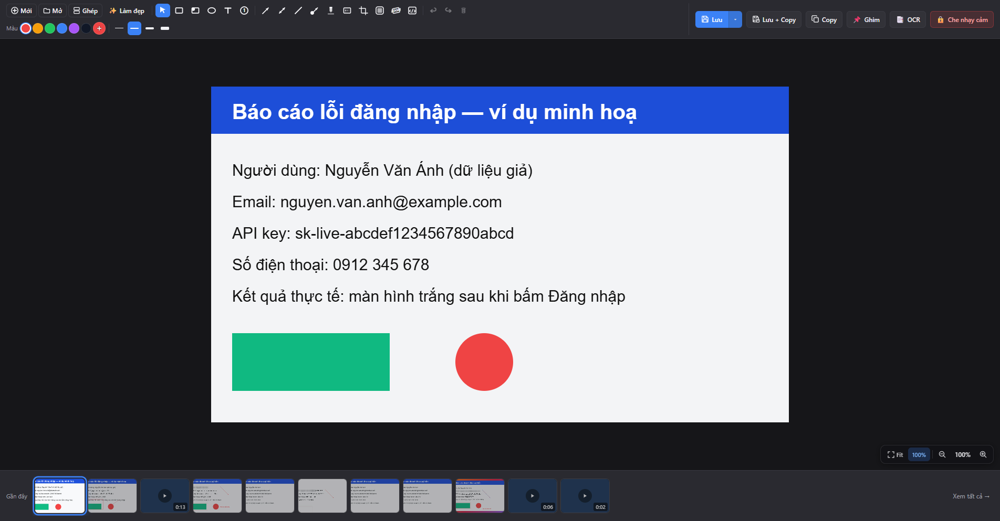
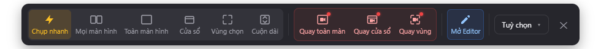
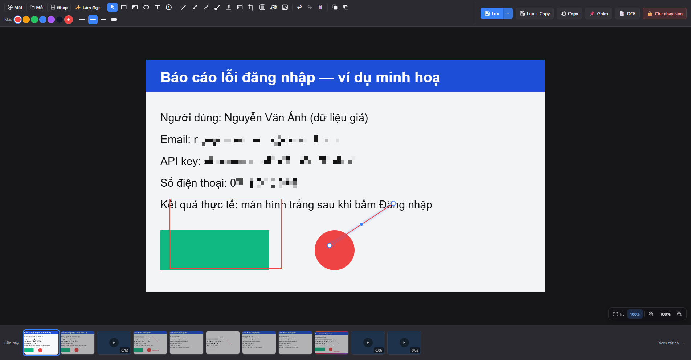
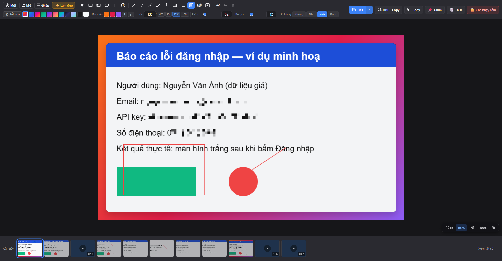
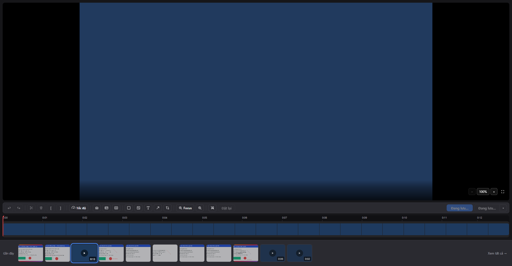
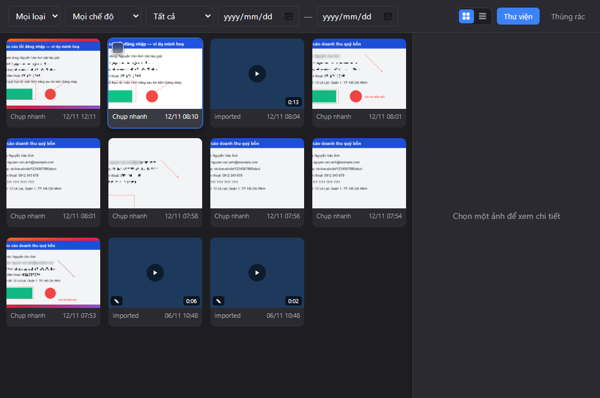
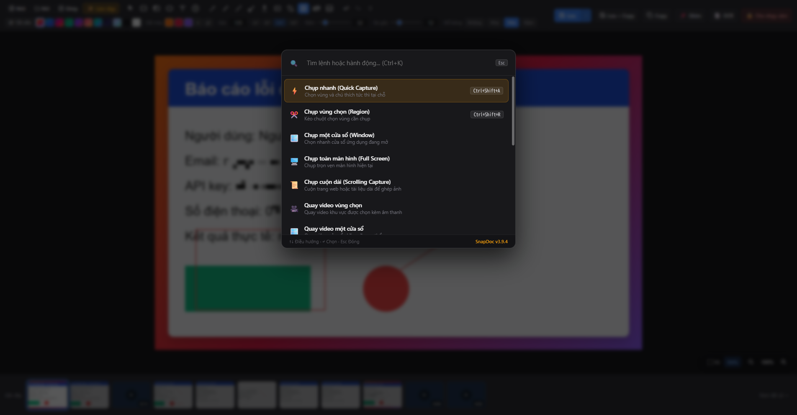
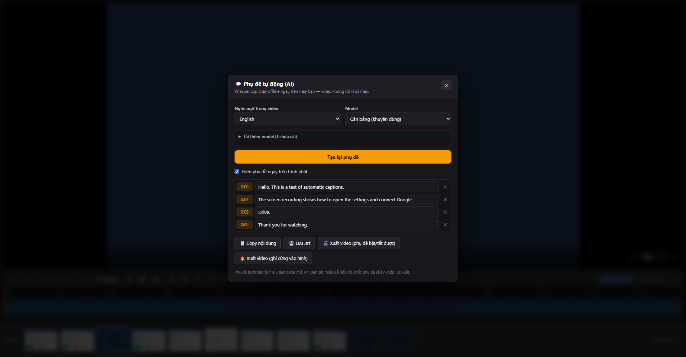
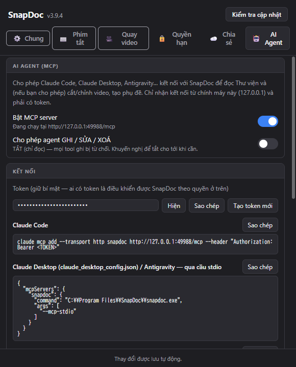
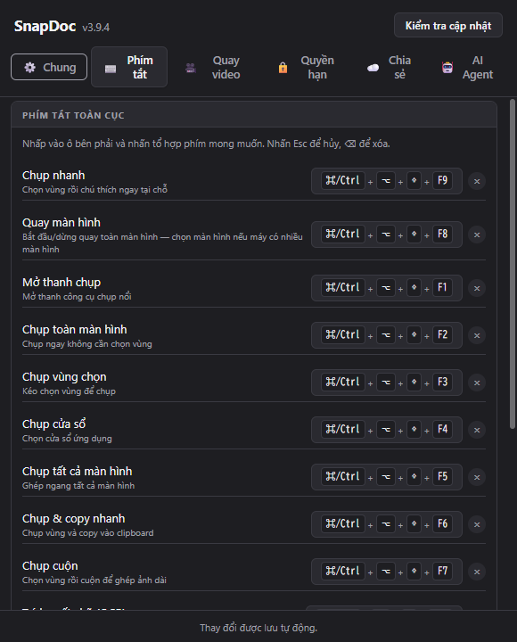

# SnapDoc

<p>
  <strong>Language / Ngôn ngữ:</strong> <a href="README.md">English</a> | <b>Tiếng Việt</b>
</p>

**SnapDoc** là ứng dụng Windows để **chụp màn hình, quay video, chú thích, trích chữ (OCR), tạo phụ đề bằng AI** và quản lý tất cả trong một Thư viện — mọi thứ xử lý **ngay trên máy bạn**, không cần tài khoản.

> Công nghệ: **Tauri 2** (Rust) + **React 19 + TypeScript + Vite** + **Konva** (canvas) + **FFmpeg** (video) + **Whisper.cpp** (phụ đề, chạy offline).
> Kiến trúc: [ARCHITECTURE.md](ARCHITECTURE.md) · Đóng gói: [BUILD.md](BUILD.md) · Bảo mật: [SECURITY.md](SECURITY.md) · AI Agent: [docs/MCP_AGENT.md](docs/MCP_AGENT.md)

<p align="center">
  
</p>

---

## Mục lục

1. [Cài đặt nhanh](#-cài-đặt-nhanh)
2. [Bắt đầu trong 5 phút](#-bắt-đầu-trong-5-phút)
3. [Tính năng](#-tính-năng)
4. [Phụ đề tự động (AI)](#-phụ-đề-tự-động-ai)
5. [Kết nối AI Agent (MCP)](#-kết-nối-ai-agent-mcp)
6. [Bảng phím tắt](#-bảng-phím-tắt)
7. [Quyền riêng tư & bảo mật](#-quyền-riêng-tư--bảo-mật)
8. [Xử lý sự cố](#-xử-lý-sự-cố)
9. [Dành cho nhà phát triển](#-dành-cho-nhà-phát-triển)

---

## 📦 Cài đặt nhanh

**Yêu cầu:** Windows 10/11 64-bit, [WebView2 Runtime](https://developer.microsoft.com/microsoft-edge/webview2/) (Windows 11 đã có sẵn). Nên có ≥ 8 GB RAM nếu dùng phụ đề AI với model lớn.

1. Tải bộ cài `SnapDoc_<phiên bản>_x64-setup.exe` (thư mục `release/` của dự án).
2. Chạy file, làm theo trình cài đặt. SnapDoc tự chạy nền và hiện biểu tượng ở khay hệ thống (cạnh đồng hồ).
3. Lần đầu mở, Windows có thể hỏi quyền (ghi màn hình, camera/micro nếu bạn dùng) — hãy cho phép.

> ℹ️ Bản cài hiện **chưa ký số** (code signing), nên Windows SmartScreen có thể cảnh báo “Unknown publisher”: bấm **More info → Run anyway**. Nếu phát hành rộng rãi, nên mua chứng chỉ ký mã — xem [BUILD.md](BUILD.md).

Gỡ cài đặt: *Settings → Apps → SnapDoc → Uninstall*. Dữ liệu (Thư viện, model phụ đề) nằm ở `%APPDATA%\com.snapdoc.app` và `%LOCALAPPDATA%\com.snapdoc.app`; trình gỡ không xoá chúng — hãy tự xoá hai thư mục này nếu muốn dọn sạch.

---

## 🚀 Bắt đầu trong 5 phút

| Bước | Làm gì |
|---|---|
| 1 | Bấm <kbd>Ctrl</kbd>+<kbd>Shift</kbd>+<kbd>5</kbd> để mở **thanh chụp** nổi. |
| 2 | Bấm <kbd>Ctrl</kbd>+<kbd>Shift</kbd>+<kbd>2</kbd> rồi **kéo chuột** quanh vùng cần chụp. |
| 3 | Ảnh mở trong **Editor**: <kbd>R</kbd> vẽ khung, <kbd>A</kbd> mũi tên, <kbd>T</kbd> chữ, <kbd>B</kbd> che mờ. |
| 4 | <kbd>Ctrl</kbd>+<kbd>C</kbd> copy ảnh · <kbd>Ctrl</kbd>+<kbd>S</kbd> lưu vào Thư viện. |
| 5 | <kbd>Ctrl</kbd>+<kbd>K</kbd> mở **bảng lệnh** — gõ “phụ đề”, “thư viện”, “hướng dẫn”… để làm nhanh mọi việc. |

<p align="center">
  
</p>

Menu **Tuỳ chọn ▾** đặt nhanh: việc làm sau khi chụp (mở Editor / copy / lưu), nguồn âm thanh khi quay, hiển thị phím bấm & click chuột, **hẹn giờ chụp** 5–10 giây, và mục **📖 Hướng dẫn sử dụng** — mở trang hướng dẫn đầy đủ có màu sắc, sơ đồ, **sửa/thêm/xoá được** nội dung.

---

## ✨ Tính năng

### 📸 Chụp ảnh
Vùng chọn · Cửa sổ · Toàn màn hình · Tất cả màn hình · **Chụp cuộn dài** (trang web, tài liệu) · **Chụp nhanh** (chú thích ngay tại chỗ) · Chụp & copy. Có hẹn giờ, hình thu nhỏ sau khi chụp (Sửa / Copy / Lưu / **Ghim** nổi trên màn hình).

### 🎬 Quay màn hình
Quay vùng / cửa sổ / toàn màn hình, kèm **Micro**, **âm thanh hệ thống** hoặc cả hai (đồng bộ cả khi tạm dừng). Hiển thị **phím bấm** và **click chuột** trên video. **Webcam Bubble** — camera tròn nổi để quay hướng dẫn.

### 🖍️ Chỉnh sửa ảnh
15+ công cụ: khung (có số), mũi tên (có số, 2 chiều), tròn, đường, chữ (có nền & mũi tên chỉ đích), đánh số bước, tô sáng, **che mờ** (Blur / Pixel hoá / Che đặc), cắt, khung code có tô màu cú pháp, **khung nền & Làm đẹp 1 chạm**, nối ảnh dài, Flatten.

<p align="center">
  
  
</p>

### 🔤 OCR & bảo vệ thông tin riêng tư
- **OCR tức thì** (<kbd>Ctrl</kbd>+<kbd>Shift</kbd>+<kbd>T</kbd>): chọn vùng bất kỳ, chữ vào clipboard — nhận tiếng Việt có dấu, chạy offline.
- **Live Text**: chữ trên ảnh bôi đen/copy được như văn bản.
- **Che nhạy cảm tự động**: quét và che mờ **email, token/API key, số điện thoại (VN & Nhật), số thẻ (Luhn), địa chỉ IP, My Number, mã bưu điện 〒** và chuỗi bí mật dạng ngẫu nhiên.

<p align="center">
  
</p>

### ✂️ Chỉnh sửa video
Cắt/chia đoạn, đổi **tốc độ** theo vùng, **Focus** (tự zoom theo chuột), con trỏ mượt, sóng nước khi click, chú thích theo thời gian (khung, che mờ, chữ, mũi tên), crop, tách âm thanh, **xuất GIF**, lưu thành video mới hoặc lưu đè.

<p align="center">
  
</p>

### 🗂️ Thư viện
Mọi ảnh/video đều được lưu, lọc theo loại/ngày, **Thùng rác** (khôi phục hoặc xoá vĩnh viễn), thao tác hàng loạt, ghim ảnh nổi, **chia sẻ qua Google Drive** của chính bạn.

<p align="center">
  
</p>

### 🔍 Bảng lệnh <kbd>Ctrl</kbd>+<kbd>K</kbd>

<p align="center">
  
</p>

---

## 💬 Phụ đề tự động (AI)

Nhận diện giọng nói thành phụ đề bằng **Whisper.cpp chạy offline** — video không rời khỏi máy. Mở bằng nút 💬 trên thanh công cụ của Editor video.

<p align="center">
  
</p>

**Luồng làm việc:** cài model (1 lần) → **Tạo phụ đề** (chạy nền, popup tiến độ nhỏ ở góc) → soát & **sửa chữ từng dòng** → xuất `.srt` hoặc video.

- **Cài model một lượt nhiều cái:** tick Nhanh (57 MB) / Cân bằng (181 MB, khuyên dùng) / Chính xác nhất (547 MB). Tải nền, đóng hộp thoại vẫn tiếp tục, đứt mạng sẽ **tải tiếp** (kiểm tra SHA-256).
- **Chạy nền, không mất việc:** đóng hộp thoại, đổi video, thậm chí đóng cả Editor — kết quả vẫn được giữ; mở lại đúng video là phụ đề đã có.
- **Xuất riêng:** `Lưu .srt` · `Xuất video (phụ đề bật/tắt được)` — rất nhanh, không mã hoá lại hình · `Xuất video (ghi cứng vào hình)`. Video đã cắt/đổi tốc độ thì mốc phụ đề **tự khớp**.
- **Chính xác hơn, ít lỗi hơn:** tự **bỏ đoạn im lặng (VAD)**, chống vòng lặp lặp câu, trộn **mọi luồng âm thanh** của video, ưu tiên GPU (CUDA) nếu engine hỗ trợ và **tự chạy lại bằng CPU** nếu GPU lỗi.
- Nên **chọn đúng ngôn ngữ trong video** thay vì “Tự nhận diện” khi video ngắn hoặc nhiều tiếng ồn.

> Tính năng **dịch** phụ đề sang ngôn ngữ khác **không** có trong bản này (cần dịch vụ bên ngoài, trái tiêu chí chạy hoàn toàn offline).

---

## 🤖 Kết nối AI Agent (MCP)

SnapDoc có **MCP server** nội bộ để Claude Code / Claude Desktop / Antigravity đọc Thư viện và — khi bạn cho phép — nhập, cắt, crop, đổi tốc độ video, tạo phụ đề.

<p align="center">
  
</p>

Ba lớp an toàn: **(1)** server tắt mặc định, chỉ nghe `127.0.0.1`, cần token, từ chối mọi request có `Origin` / `Host` lạ; **(2)** công tắc **“Cho phép agent ghi/sửa/xoá”** riêng (mặc định tắt = chỉ đọc); **(3)** thao tác phá huỷ (đưa vào Thùng rác…) luôn hiện **hộp thoại xác nhận** của Windows, và **nhật ký** mọi thao tác agent xem được trong app. Hướng dẫn kết nối: [docs/MCP_AGENT.md](docs/MCP_AGENT.md).

---

## ⌨️ Bảng phím tắt

Phím tắt **toàn cục** (đổi được ở *Cài đặt › Phím tắt*):

| Việc | Phím |
|---|---|
| Chụp toàn màn hình / vùng / cửa sổ / tất cả màn hình | <kbd>Ctrl</kbd>+<kbd>Shift</kbd>+<kbd>1</kbd> / <kbd>2</kbd> / <kbd>3</kbd> / <kbd>4</kbd> |
| Mở thanh chụp | <kbd>Ctrl</kbd>+<kbd>Shift</kbd>+<kbd>5</kbd> |
| Chụp cuộn dài | <kbd>Ctrl</kbd>+<kbd>Shift</kbd>+<kbd>6</kbd> |
| Quay màn hình (bắt đầu/dừng) | <kbd>Ctrl</kbd>+<kbd>Shift</kbd>+<kbd>7</kbd> |
| Chụp nhanh (chú thích tại chỗ) | <kbd>Ctrl</kbd>+<kbd>Shift</kbd>+<kbd>Q</kbd> |
| Chụp & copy nhanh | <kbd>Ctrl</kbd>+<kbd>Shift</kbd>+<kbd>C</kbd> |
| Trích chữ (OCR) vào clipboard | <kbd>Ctrl</kbd>+<kbd>Shift</kbd>+<kbd>T</kbd> |
| Bảng lệnh | <kbd>Ctrl</kbd>+<kbd>K</kbd> |

**Trong Editor ảnh:** <kbd>V</kbd> chọn · <kbd>R</kbd> khung · <kbd>E</kbd> khung số · <kbd>O</kbd> tròn · <kbd>A</kbd> mũi tên · <kbd>W</kbd> mũi tên số · <kbd>D</kbd> mũi tên 2 chiều · <kbd>L</kbd> đường · <kbd>T</kbd> chữ · <kbd>N</kbd> đánh số · <kbd>H</kbd> tô sáng · <kbd>B</kbd> che mờ · <kbd>C</kbd> cắt · <kbd>G</kbd> khung nền · <kbd>K</kbd> khung code · <kbd>Esc</kbd> thoát.
**Trong Editor video:** <kbd>Q</kbd> cắt đầu · <kbd>W</kbd> cắt đuôi · <kbd>Ctrl</kbd>+<kbd>B</kbd> chia đoạn · <kbd>Delete</kbd> xoá đoạn · <kbd>Ctrl</kbd>+<kbd>S</kbd> lưu đè · <kbd>Ctrl</kbd>+<kbd>Shift</kbd>+<kbd>S</kbd> lưu thành video mới.

<p align="center">
  
</p>

---

## 🔒 Quyền riêng tư & bảo mật

- **Mặc định offline:** chụp, quay, OCR, phụ đề đều chạy trên máy. Chỉ khi bạn bấm **Chia sẻ qua Drive** thì tệp đó mới được tải lên **Google Drive của bạn**.
- **Mã hoá token Drive** bằng Windows DPAPI; đăng nhập Google dùng PKCE `S256` + `state` ngẫu nhiên và chỉ chấp nhận đúng callback của lần đăng nhập đó.
- **Tải về có kiểm tra:** engine Whisper & model được **ghim SHA-256**, tải tiếp được, không chạy gì chưa qua kiểm tra.
- **Quyền Tauri tối thiểu theo cửa sổ:** cửa sổ làm việc (Editor, Thư viện, Cài đặt) có quyền đầy đủ; cửa sổ tạm (thanh chụp, overlay, thumbnail…) dùng bộ quyền hẹp — không tạo được cửa sổ mới hay mở URL.
- **Mở file `.snapdoc` lạ an toàn:** giới hạn kích thước giải nén (chống “zip bomb”).
- **Thống kê ẩn danh (Aptabase)** chỉ hoạt động nếu bản build có `APTABASE_KEY`; bản tự build mặc định **không có** → không gửi gì. Nếu bật, chỉ có 2 sự kiện `app_started` / `capture_done`, không kèm nội dung hay đường dẫn.
- **Tự cập nhật đã tắt** trong bản này; nâng cấp bằng cách chạy bộ cài mới.

Báo lỗ hổng bảo mật: xem [SECURITY.md](SECURITY.md).

---

## 🛟 Xử lý sự cố

| Triệu chứng | Cách xử lý |
|---|---|
| Phím tắt không chạy | Phần mềm khác đang chiếm tổ hợp đó → đổi ở *Cài đặt › Phím tắt*. |
| Chụp ra ảnh đen | Kiểm tra *Cài đặt › Quyền hạn*; một số cửa sổ có bảo vệ nội dung (phát phim bản quyền) bị Windows chặn chụp. |
| Phụ đề đứng ở một % rất lâu | Model “Chính xác nhất” chạy CPU khá chậm với video dài — thử “Cân bằng”, chọn đúng ngôn ngữ; popup có đồng hồ để biết vẫn đang chạy. Bấm ✕ để huỷ. |
| Phụ đề sai ngôn ngữ / chữ lạ | Chọn đúng *Ngôn ngữ trong video* thay vì “Tự nhận diện”; thử model lớn hơn. |
| Tải model bị đứt | Bấm “Tải về & cài đặt” lần nữa — tải tiếp từ phần đã có. |
| Cần chạy lại sau khi đóng Editor | Không cần: kết quả phụ đề được giữ, mở lại video là có. (Chỉ **thoát hẳn SnapDoc** mới dừng tác vụ đang chạy.) |

---

## 🛠️ Dành cho nhà phát triển

```powershell
# Yêu cầu: Node 20+, Rust stable (MSVC), Visual Studio Build Tools (C++), FFmpeg sidecar trong src-tauri/binaries/
npm install
npm run tauri dev                    # chạy chế độ phát triển
npx tauri build --bundles nsis       # đóng gói bộ cài Windows (NSIS)
```

- Kiểm tra: `npx tsc --noEmit` · `npx vitest run` · `cd src-tauri; cargo test`.
- **E2E thật** (điều khiển app bằng DevTools Protocol, dùng bản build **cô lập** để không đụng bản đang cài): xem [scripts/e2e/README.md](scripts/e2e/README.md). Ảnh minh hoạ trong README này được chụp tự động bằng `node scripts/e2e/s14_readme_shots.mjs`.
- Trang hướng dẫn trong app: sửa `docs/guide/guide.template.html` rồi chạy `node scripts/build-guide.mjs`.
- Mẹo build trên Windows: đặt `CARGO_TARGET_DIR` về một đường dẫn **ngắn, thuần ASCII** (vd `C:\sdt`) nếu đường dẫn dự án có dấu — tránh lỗi `lib.exe`/`autocfg`; giảm `-j 2` khi RAM thấp.

Cấu trúc chính: `src/` (React UI) · `src-tauri/src/` (Rust: `captions.rs` phụ đề, `mcp/` AI Agent, `history/` Thư viện, `record/` quay, `windows/` cửa sổ) · `scripts/e2e/` (E2E) · `docs/` (tài liệu).

---

## 📄 Bản quyền

Xem tệp `LICENSE` (nếu có) và các giấy phép của thư viện bên thứ ba (Whisper.cpp — MIT, FFmpeg — LGPL/GPL tuỳ bản dựng, Tesseract/PaddleOCR/ONNX Runtime…). Dự án gốc của tác giả upstream; bản này là nhánh cá nhân với các cải tiến về phụ đề, AI Agent, bảo mật và tài liệu.
